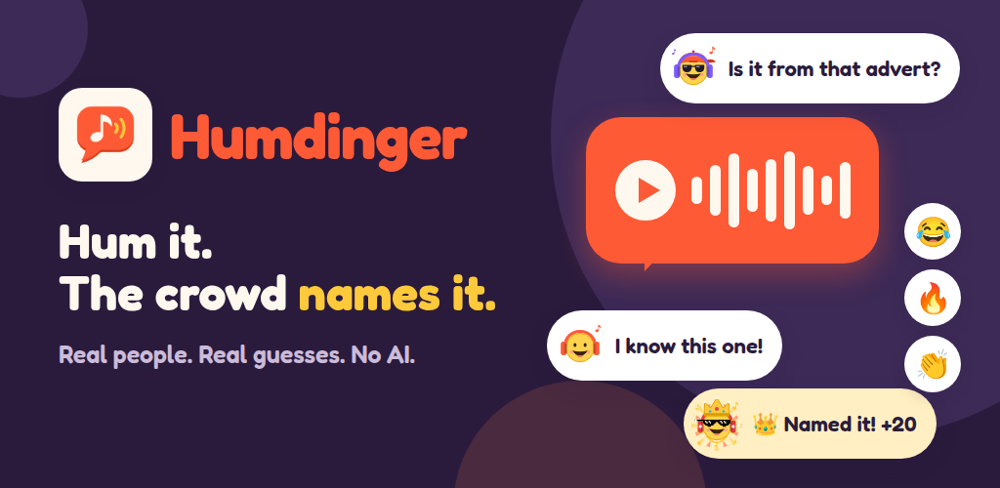
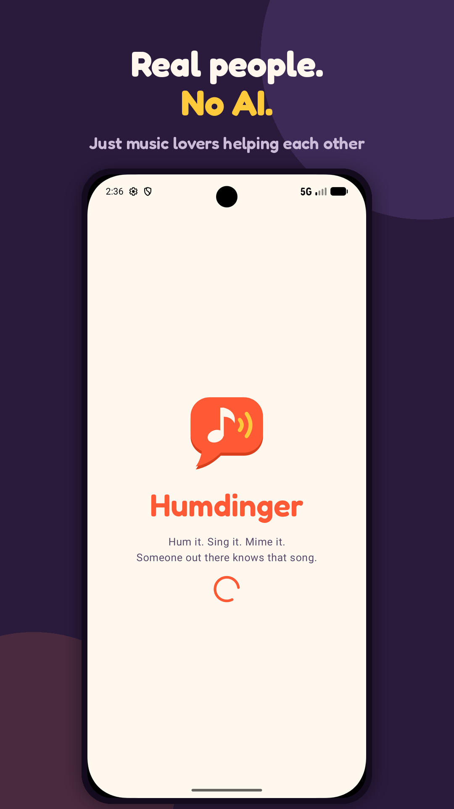
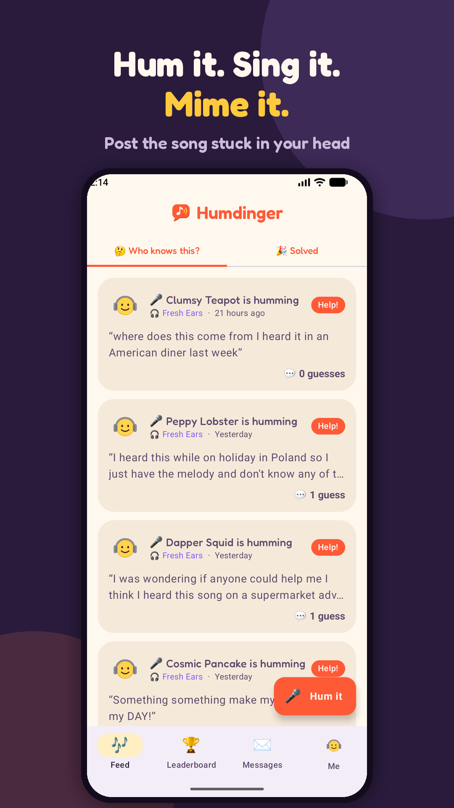
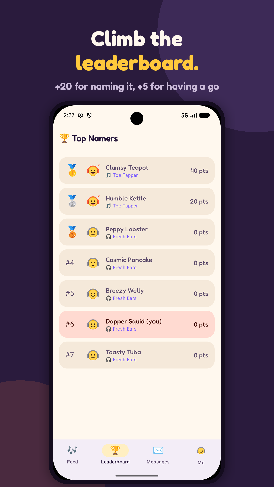
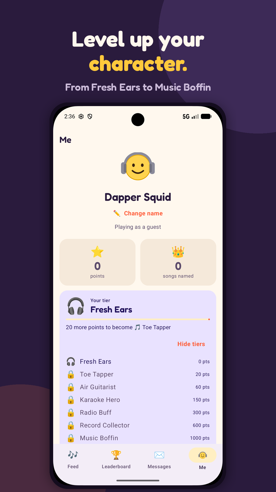
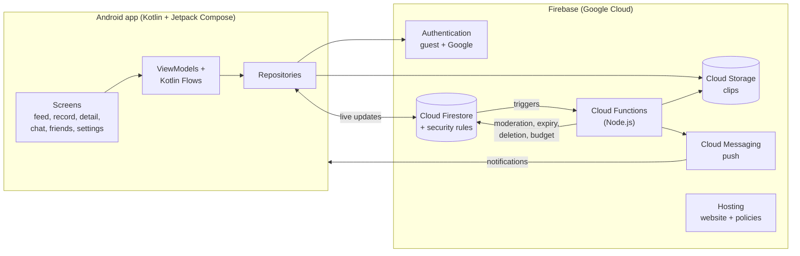

<p align="center">
  
</p>

<h1 align="center">Humdinger</h1>

<p align="center">
  <b>Got a song stuck in your head but can't name it? Hum it, sing it or mime it, and real people name it for you.</b><br>
  An Android app built end to end: product, design, app, backend, moderation, privacy and Play Store release.
</p>

<p align="center">
  <a href="#-try-it">Try the beta</a> ·
  <a href="https://humdinger-61b7b.web.app">Website</a> ·
  <a href="#-whats-inside">Features</a> ·
  <a href="#%EF%B8%8F-how-its-built">Architecture</a>
</p>

---

## 📱 Try it

Humdinger is in **closed testing on Google Play** (Android 8.0 and newer). Anyone can join in about two minutes:

1. **Join the tester group:** https://groups.google.com/g/humdinger-testers
2. **Opt in to the test:** https://play.google.com/apps/testing/com.kowalski.humdinger
3. **Install from Google Play:** https://play.google.com/store/apps/details?id=com.kowalski.humdinger

Use the same Google account for all three steps. If the Play Store says "Item not found", give it up to 30 minutes after opting in.

<p align="center">
  
  
  
  
</p>

## 💡 The idea

Song-recognition apps need the actual recording. Humdinger is for the songs you can only half-remember: you post a short hum, sing-along or mime (up to 30 seconds) with an optional clue, and the community guesses. **No AI: just people who love music helping each other.**

- **Whoever names it gets 20 points**, and everyone who had a go gets 5, so people are rewarded for joining in, not just for winning.
- Points level up your character through eight tiers, from *Fresh Ears* to *Humdinger Legend*.
- The person who asked can say thank you with a written, hummed or video message, which opens a chat.

## ✨ What's inside

**Playing**
- Record a hum (audio) or a mime (video) in the app, add a clue, and choose how long it stays up (1 day to 3 months)
- Guess with a link to the song (YouTube, Spotify, Apple Music, Deezer, SoundCloud, TIDAL, Amazon Music and more)
- The requester crowns the right answer; points are handed out in one atomic, server-verified transaction
- Reactions, comments on hums, and threaded replies under guesses ("so close, but it's slower!")
- Leaderboard, tiers and level-up celebrations, and a "✨ New" badge for songs solved while you were away

**Social**
- Friends: request, accept, message each other, and get notified when a friend posts a hum
- Thank-you messages (text, audio or video) that turn into a private chat
- Push notifications for guesses, comments, replies, crowns, thank-yous, messages and friends' hums

**Settings and privacy**
- A switch for every kind of notification, quiet hours (silent delivery) and an optional daily summary
- Who can send me friend requests / message me / comment on my hums, and opt out of the leaderboard
- Automatic dark mode from 8pm to 8am (or follow the phone, always light, always dark)
- Guest accounts with random fun names (unique, filtered), upgradeable to Google sign-in without losing points

**Safety, moderation and compliance**
- House rules agreed on first launch; minimum age 16
- Report and block everywhere (clips, guesses, comments, replies, people, chats); blocking is enforced by the database rules
- Automatic removal of a clip after reports from several established accounts, with a notice to the owner explaining why
- A light-touch comment filter (slurs, hate and bullying blocked; everyday swearing allowed) and a stricter name filter
- In-app account deletion that removes every trace (clips, guesses, chats, friends, reports), plus a web deletion page
- A privacy policy, house rules and data deletion pages hosted on the project's own website, GDPR (General Data Protection Regulation) based
- Cost guard: an hourly job watches Cloud Storage usage and switches to audio-only, then pauses new recordings, before the free allowance runs out

## 🏗️ How it's built



**Android app** (`app/`)
- Kotlin, Jetpack Compose with Material 3, Navigation Compose, ViewModels with StateFlow
- CameraX and MediaRecorder for recording; Media3 ExoPlayer for playback
- Credential Manager for Google sign-in; Firebase Cloud Messaging for push, with a separate silent channel for quiet hours
- Live data straight from Firestore snapshot listeners wrapped as Kotlin Flows

**Backend** (`functions/`, `firebase/`)
- **Security rules (~540 lines)** are the real backend logic: they validate every write, so points can't be faked, blocked people can't reach you, privacy choices are enforced, and recordings pause when the storage budget is low, even for an old or modified app
- **15 Cloud Functions** for push notifications (respecting each person's settings, quiet hours and daily summaries), report-based auto-moderation, scheduled expiry of clips, full account deletion, and the storage-budget guard using Cloud Monitoring metrics
- Firebase Hosting for the website, privacy policy, house rules and account-deletion page (`website/`, generated by `tools/build_website.py`)

**Release**
- Published through Google Play Console: store listing, content rating, data safety form, target audience, Play App Signing, and a closed test track with a Google Group of testers

### Project layout

```
app/src/main/java/com/kowalski/humdinger/
├── data/          models, repositories, friends, privacy, filters, settings
├── ui/            Compose screens: feed, detail, record, inbox, friends, settings, profile
├── push/          notifications and deep links
└── MainActivity.kt
functions/index.js     Cloud Functions (notifications, moderation, expiry, deletion, budget)
firebase/              Firestore and Storage security rules, indexes
website/               privacy policy, house rules, account deletion (Firebase Hosting)
tools/                 website generator
```

### By the numbers

| | |
|---|---|
| Kotlin | ~8,000 lines across 40+ files |
| Security rules | ~580 lines (Firestore + Storage) |
| Cloud Functions | 15, ~800 lines of Node.js |
| Min / target Android | 8.0 (API 26) / 16 (API 36) |

## 🛠️ Running it yourself

You'll need Android Studio, a Firebase project (Blaze plan, for Cloud Functions) and the Firebase CLI (command-line tools).

1. Create a Firebase project with Authentication (Anonymous + Google), Firestore, Storage, Cloud Messaging and Hosting
2. Add an Android app with package `com.kowalski.humdinger` and put its `google-services.json` in `app/` (it's not in this repository)
3. Deploy the backend: `cd functions && npm install && cd .. && firebase deploy`
4. Open the project in Android Studio and run it

Step-by-step notes are in [SETUP.md](SETUP.md).

## 👋 About

Built by **Christopher Kowalski**, a data analyst in Düsseldorf, as a solo project: from the idea and the points design to the Play Store release. I designed the product, made the decisions and tested it on emulators and real phones, using Claude (Anthropic's AI assistant) as a pair programmer for much of the code.

© 2026 Christopher Kowalski. All rights reserved. The code is shared to show the work; please ask before reusing it.
